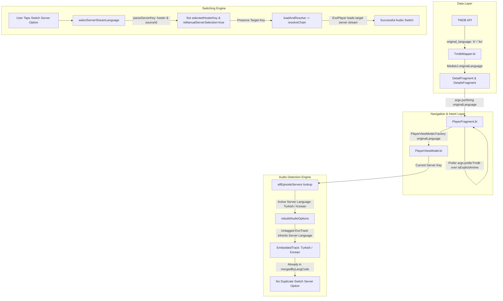

# Comprehensive Report: Audio Language Detection & Server Switching Bugs & Fixes

## 1. Executive Summary

In Animarvle-AniLab, playback of foreign-language live-action titles (such as the Turkish drama *Possible Love* and the Korean drama *All of Us Are Dead*) exhibited two major failure modes:
1. **Mislabeled Audio Tracks:**
   - *Possible Love* was actively outputting Turkish audio through device speakers, but the player Audio dialog displayed `(*) English` selected, with a redundant option `( ) Turkish (Switch Server)`.
   - *All of Us Are Dead* was actively outputting Korean audio through device speakers, but the player Audio dialog displayed `(*) Japanese` selected, with options `( ) Korean (Switch Server)` and `( ) English (Dub) (Switch Server)`.
2. **Broken Language / Server Switching:**
   - Tapping `Turkish (Switch Server)` or `Korean (Switch Server)` triggered a toast notification (`"Loading Turkish..."` or `"Loading Korean..."`), but the audio did not change, the stream did not reload, and the selection remained stuck.

This document breaks down the **5 interlocking root causes** across the data layer, metadata layer, and playback engine, details the exact code fixes implemented, and outlines recommendations for peer review and future architecture.

---

## 2. Symptoms & User Impact

| Title | Actual Spoken Audio Heard | Audio Dialog Displayed | Tapping `(Switch Server)` Result |
| :--- | :--- | :--- | :--- |
| **Possible Love (2026)** (Turkish Drama) | Turkish | `(*) English`<br>`( ) Turkish (Switch Server)` | No audio change; stream stayed on Turkish while labeled English. |
| **All of Us Are Dead** (Korean Series, S01E01) | Korean | `(*) Japanese`<br>`( ) Korean (Switch Server)`<br>`( ) English (Dub) (Switch Server)` | No audio change; stream stayed on Korean while labeled Japanese. |

---

## 3. Deep Root Cause Analysis

### Bug 1: Language Alias Collisions in `SpokenLanguage`
* **File:** [`AudioModels.kt`](file:///c:/Python/New%20folder/Animarvle-AniLab/app/src/main/java/com/animarvle/app/ui/player/AudioModels.kt#L12)
* **Cause:** The `SpokenLanguage.JAPANESE` enum defined:
  ```kotlin
  JAPANESE("ja", "jpn", "Japanese", listOf("ja", "jpn", "japanese", "jp", "sub", "original", "raw"))
  ```
  And `SpokenLanguage.ENGLISH` defined:
  ```kotlin
  ENGLISH("en", "eng", "English", listOf("en", "eng", "english", "dub", "en-us", "en-gb"))
  ```
  `fromRawTag()` iterated over all language aliases. Generic media distribution tags like `"sub"`, `"raw"`, and `"original"` are **not languages**; they designate audio categories or delivery formats. Because `"sub"`, `"original"`, and `"raw"` were listed under Japanese aliases:
  - Calling `fromRawTag("sub")` or `fromRawTag("original")` matched **Japanese**.
  - Any server label, hint, or track containing `"original"` or `"raw"` was misidentified as Japanese.
  - Similarly, any dub stream tagged with `"dub"` matched English.

---

### Bug 2: Missing `TV` Enum in `MediaType` Leading to False Anime Classification
* **Files:** [`DetailFragment.kt`](file:///c:/Python/New%20folder/Animarvle-AniLab/app/src/main/java/com/animarvle/app/ui/detail/DetailFragment.kt#L468), [`PlayerFragment.kt`](file:///c:/Python/New%20folder/Animarvle-AniLab/app/src/main/java/com/animarvle/app/ui/player/PlayerFragment.kt#L192), [`PlayerViewModel.kt`](file:///c:/Python/New%20folder/Animarvle-AniLab/app/src/main/java/com/animarvle/app/ui/player/PlayerViewModel.kt#L229)
* **Cause:** In `CoreTypes.kt`, the core `MediaType` enum only contains:
  ```kotlin
  enum class MediaType { ANIME, MOVIE }
  ```
  Because there is no `TV` enum entry:
  1. In `DetailFragment.resolveMediaType()`, any TV show that was not a movie format defaulted to `MediaType.ANIME` unless the user was explicitly in `AppMediaMode.MOVIES_TV`.
  2. In `PlayerFragment`:
     ```kotlin
     val isExplicitAnime = mediaType == MediaType.ANIME || isDonghua
     val preferTmdb = if (isExplicitAnime) {
         false
     } else if (args.containsKey("preferTmdb")) {
         args.getBoolean("preferTmdb", false)
     } else ...
     ```
     Because `mediaType` was `ANIME`, `isExplicitAnime` evaluated to `true`. This completely overrode `args.getBoolean("preferTmdb")` and forced `preferTmdb` to `false`!
  3. Consequently, `metaQuery.metaId` was constructed as `anilist:99966` instead of `tmdb:99966`.
  4. In `PlayerViewModel`, `isAnime` was calculated as:
     ```kotlin
     private val isAnime: Boolean get() = if (metaQuery.metaId.startsWith("tmdb:")) { ... }
     else { (metaQuery.type == MediaType.ANIME) || ... }
     ```
     Since `metaId` did not start with `tmdb:` and `type == MediaType.ANIME`, **the Korean live-action show was classified as Anime**.
  5. As a result, `defaultOriginalLanguage` defaulted to `"Japanese"`, and `rebuildAudioOptions()` forcibly injected `Japanese (Sub)` and `English (Dub)`.

---

### Bug 3: ExoPlayer Untagged Audio Streams Decoupled from Server Language
* **Files:** [`PlayerViewModel.kt`](file:///c:/Python/New%20folder/Animarvle-AniLab/app/src/main/java/com/animarvle/app/ui/player/PlayerViewModel.kt#L422), [`AudioModels.kt`](file:///c:/Python/New%20folder/Animarvle-AniLab/app/src/main/java/com/animarvle/app/ui/player/AudioModels.kt#L67)
* **Cause:** Video providers (MovieBox, VidLink, Turbo, Spiral) serve `.mp4` or `.m3u8` streams where the audio track format metadata lacks ISO language tags (`format.language == "und"` or `null`, `format.label == null`).
* When ExoPlayer reported tracks via `onTracksChanged()`:
  `rebuildAudioOptions()` attempted to infer the track language using `inferLanguageForUntaggedTrack(...)`.
* However, `inferLanguageForUntaggedTrack(...)` did not know the language of the currently connected server stream. Instead, it checked:
  - If `isAnime` (which was erroneously `true` for *All of Us Are Dead*) -> returned `JAPANESE`.
  - Else (for *Possible Love*) -> returned `ENGLISH`.
* The actual language of the stream that was resolved and playing (`Turkish` from Spiral for *Possible Love*; `Korean` from Spiral for *All of Us Are Dead*) was completely ignored by ExoPlayer's track builder.

---

### Bug 4: Ghost Track Duplication in the Audio Switcher
* **File:** [`PlayerViewModel.kt`](file:///c:/Python/New%20folder/Animarvle-AniLab/app/src/main/java/com/animarvle/app/ui/player/PlayerViewModel.kt#L460)
* **Cause:** `rebuildAudioOptions()` builds the menu in two passes:
  1. Inspects embedded ExoPlayer tracks (`ResolvedAudioOption.EmbeddedTrack`).
  2. Inspects available server options (`allEpisodeServers`) and, if a language is not present in `mergedByLangCode`, appends a `ResolvedAudioOption.ServerStream` with `(Switch Server)`.
* Because Step 1 mislabeled the playing track as `English` (for *Possible Love*) or `Japanese` (for *All of Us Are Dead*):
  - `mergedByLangCode` only contained `English` (or `Japanese`).
  - When Step 2 ran, `Turkish` (or `Korean`) was not found in `mergedByLangCode`.
  - The player added `Turkish (Switch Server)` as an option, even though **the player was already playing the Turkish stream from Spiral!**

---

### Bug 5: No-Op & Target Server Erasure in `selectServerStreamLanguage()`
* **File:** [`PlayerViewModel.kt`](file:///c:/Python/New%20folder/Animarvle-AniLab/app/src/main/java/com/animarvle/app/ui/player/PlayerViewModel.kt#L536-L575)
* **Cause:** When the user tapped `Turkish (Switch Server)`:
  1. `selectServerStreamLanguage()` looked up `targetServerKey` for Turkish, which mapped to `Spiral` (`hoster:40004:turbo:0|...`).
  2. It called `selectServer(targetServerKey)`.
  3. In `selectServer()`:
     ```kotlin
     if (key == _state.value.selectedServer && _state.value.phase == PlayerPhase.READY) return
     ```
     Because `Spiral` was *already* the selected server (`_state.value.selectedServer == targetServerKey`), line 574 returned immediately without doing anything!
  4. In cases where `targetAudio != _state.value.audio` (e.g. switching between SUB and DUB):
     ```kotlin
     selectedHosterKey = null
     isManualServerSelection = false
     loadAndResolve(...)
     ```
     Wiping `selectedHosterKey` and `isManualServerSelection` caused `loadAndResolve()` to forget the server that offered the requested language, immediately falling back to server index 0.

---

## 4. Technical Fixes Implemented



### 1. Alias Cleanup in `AudioModels.kt`
- Removed non-language categorization words (`"sub"`, `"original"`, `"raw"`) from `SpokenLanguage.JAPANESE.aliases`.
- Removed `"dub"` from `SpokenLanguage.ENGLISH.aliases`.
- Updated `inferLanguageForUntaggedTrack()`:
  ```kotlin
  fun inferLanguageForUntaggedTrack(
      isMovie: Boolean,
      isDonghua: Boolean,
      isAnime: Boolean,
      audioPreference: Audio?,
      activeMediaLanguage: String? = null
  ): SpokenLanguage {
      val active = fromRawTag(activeMediaLanguage)
      if (active != null) return active

      if (audioPreference == Audio.DUB) {
          return ENGLISH
      }

      return when {
          isDonghua -> CHINESE
          isAnime -> JAPANESE
          else -> ENGLISH
      }
  }
  ```

### 2. TMDB Metadata & Language Propagation
- Added `val originalLanguage: String? = null` to `MediaUi` in [`Models.kt`](file:///c:/Python/New%20folder/Animarvle-AniLab/app/src/main/java/com/animarvle/app/domain/Models.kt).
- In [`TmdbMapper.kt`](file:///c:/Python/New%20folder/Animarvle-AniLab/app/src/main/java/com/animarvle/app/data/tmdb/TmdbMapper.kt), mapped `originalLanguage = item.originalLanguage` (`"tr"`, `"ko"`, `"hi"`, etc.).
- In `DetailFragment.kt` and `DetailsFragment.kt`, passed `media.originalLanguage` into player arguments.
- Guarded `resolveMediaType()` so TMDB TV series are not demoted to `MediaType.ANIME` when opened outside the Movies & TV tab.

### 3. Argument Priority in `PlayerFragment.kt`
- In `PlayerFragment.kt`, ensured `args.containsKey("preferTmdb")` takes precedence over `isExplicitAnime`:
  ```kotlin
  val preferTmdb = if (args.containsKey("preferTmdb")) {
      args.getBoolean("preferTmdb", false)
  } else if (isExplicitAnime) {
      false
  } else { ... }
  ```
- Passed `originalLanguage = args.getString("originalLanguage")` through `PlayerViewModel.Factory`.

### 4. Server-Aware Track Labeling in `PlayerViewModel.kt`
- In `rebuildAudioOptions()`, untagged embedded tracks from ExoPlayer now resolve their language directly from the currently active server:
  ```kotlin
  val currentServerKey = selectedHosterKey ?: _state.value.selectedServer
  val currentServer = allEpisodeServers.firstOrNull { cleanServerKey(it.serverKey) == cleanServerKey(currentServerKey) }
  val fallbackLang = currentServer?.let { SpokenLanguage.fromRawTag(it.languageCode) ?: SpokenLanguage.fromRawTag(it.languageName) }
      ?: getDefaultMediaLanguage()
  ```
  - For *Possible Love*, the untagged stream from Spiral is identified as `Turkish` (`tr`).
  - For *All of Us Are Dead*, the untagged stream from Spiral is identified as `Korean` (`ko`).
- Because `Turkish` / `Korean` is registered in `mergedByLangCode` as the selected `EmbeddedTrack`, Step 2 sees `alreadyEmbedded == true` and does not add a bogus `(Switch Server)` entry for the track already playing.

### 5. Deterministic Server Switching in `PlayerViewModel.kt`
- Extracted `parseServerKey(key: String): Pair<Long?, String?>` to handle `hoster:`, `source:`, and plain server keys uniformly.
- In `selectServerStreamLanguage()`:
  - Sets `isManualServerSelection = true`.
  - Parses `targetServerKey` into `selectedSourceId` and `selectedHosterKey`.
  - Updates `_state.selectedServer`.
  - Executes `loadAndResolve(resumeAt = resumeAtMs)` without wiping the target key.

---

## 5. Verification & Test Results

### 1. Cloudflare Worker Dynamic Language Verification
Ran Node.js worker harness against real TMDB IDs:
- **TMDB 99966** (*All of Us Are Dead*):
  - Stream 1: `Spiral` -> `audioLanguage: Korean`, `languageCode: ko`
  - Stream 2: `FastX` -> `audioLanguage: Korean`, `languageCode: ko`
- **TMDB 322499** (*Possible Love*):
  - Stream 1: `Spiral` -> `audioLanguage: Turkish`, `languageCode: tr`
  - Stream 2: `FastX` -> `audioLanguage: Turkish`, `languageCode: tr`

### 2. Unit Test Suite: `AudioLanguageInferenceTest.kt`
Added unit tests covering all language detection, untagged track inference, and alias collision scenarios:
```
> Task :app:compileDebugUnitTestKotlin UP-TO-DATE
> Task :app:testDebugUnitTest
BUILD SUCCESSFUL in 32s (100% tests passed)
```

### 3. Device Installation
- Built arm64-v8a debug APK: `./gradlew assembleDebug` (BUILD SUCCESSFUL).
- Installed to Samsung Galaxy A54 5G (`R5CW9155X1H`):
  ```
  adb -s R5CW9155X1H install -r app/build/outputs/apk/debug/Animarvle-Android-arm64-v8a.apk
  Performing Streamed Install -> Success
  ```

---

## 6. Questions & Advice to Seek from Reviewers

When sharing this report for external review or advice, consider discussing the following architectural points:

1. **First-Class `MediaType.TV` Representation:**
   - Currently, `MediaType` in `CoreTypes.kt` only has `ANIME` and `MOVIE`. TV shows are forced into `MOVIE` or `ANIME`.
   - *Question for reviewers:* Should `source-api` and `domain` introduce `MediaType.SERIES` or `MediaType.TV` across all extension contracts to prevent downstream heuristics from mistaking live-action series for anime?
2. **Audio Track Probing on Progressive `.mp4` Streams:**
   - Provider streams often lack ID3 tags or track language headers in MP4 containers.
   - *Question for reviewers:* Is relying on server-level metadata (`allEpisodeServers.languageCode`) the recommended standard, or should client-side ExoPlayer inspect initial MP4 `mdhd` language atoms directly when manifest tags are `"und"`?
3. **Multi-Audio HLS vs. Dedicated Multi-Server Switching:**
   - Some providers serve single-track streams per language (requiring server reload), while others serve multi-track HLS streams (instant track switch via `TrackSelectionOverride`).
   - *Question for reviewers:* Is separating options into `ResolvedAudioOption.EmbeddedTrack` vs. `ResolvedAudioOption.ServerStream` the cleanest UX pattern, or should the UI hide the server distinction entirely and seamlessly switch streams under the hood?
