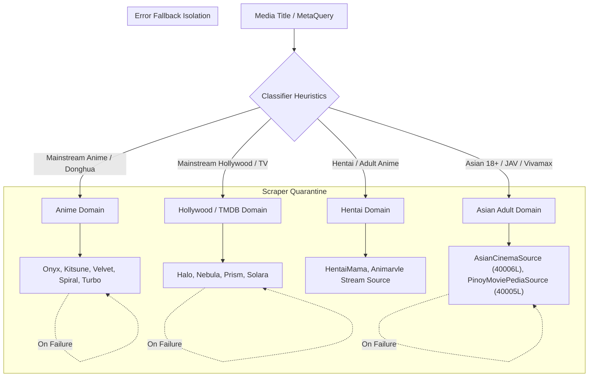

# Content Quarantine, Server Separation & Playback Optimization

## 1. Executive Summary

This document details the architectural redesign and implementation that resolved cross-domain contamination in Animarvle-AniLab:
1. **Content Domain Mixing:** Preventing standard anime scrapers (Gogo, HiAnime, Zoro) from colliding with adult anime (Hentai), mainstream Hollywood movies/series (Halo, Solara), and Asian adult cinema (Cat3Movie, JavMost, PinoyMoviePedia).
2. **Server Identity Morphing & Vanishing Acts:** Eliminating the discrepancy where servers appeared under plugin names (e.g., *"Asian Cinema (18+)"*) when inactive, but switched to internal hoster names (e.g., *"Cat3 Direct HD (HLS / MP4)"*) when active.
3. **Host Server Aliasing (Halo vs. Pinoy / Vivamax):** Fixing the bug where PinoyMoviePedia's direct hoster (`Playmogo`) fell through to `HALO`, erroneously rendering Halo with a Philippine flag (🇵🇭) while leaving the dedicated `Pinoy / Vivamax` server unselected with a grey dot (`AVAILABLE`).
4. **Cellular Data Waste & MB Spikes:** Enforcing a strict 8 MB ExoPlayer buffer ceiling and instant 800ms start time while immediately aborting hung HTTP sockets when switching servers.

---

## 2. 4-Way Content Partitioning & Quarantine Architecture



### 2.1 Detection Heuristics (`AnimarvleApp.kt`)
* **Japanese Adult Studio Codes:** `\b[A-Za-z]{2,6}[-_]?\d{2,5}\b` matches codes including `SW-339`, `SSIS-123`, `IPX-456`, `MIDV-789`, `JUL-012`, `SONE-345`, `STARS-678`, `ABP-901`, `SSNI-234`, and `PRED-567`.
* **Vivamax & Asian Adult Keywords:** 80+ curated keywords in `isAsianAdultTitle` and `isPinoyTitle`:
  `hot moves`, `sex drive`, `gl forever`, `choosy`, `palitan`, `bela luna`, `virgin forest`, `silip sa apoy`, `alindog`, `sukdulan`, `dutdot`, `haliparot`, `putahe`, `kolehiyala`, `hilom`, `us x her`, `relyebo`, `bula`, `pamasahe`, `sabel`, `siklo`, `moonlight butterfly`, `kinsenas`, `katapusan`, `eva`, `mahjong nights`, `kaliwaan`, `island of desire`, `hugot`, `doblado`, `laruan`, `afam`, `sex hub`, `hosto`, `boso dos`, `tuhog`, `salawahan`, `paupahan`, `pantaxa`, `kabayo`, `bomba`, `suki`, `bugso`, `nightbird`, `tayuan`, `fall guy`, `balisong`, `balikbayan`, `showroom`, `tubero`, `star dancer`, `alapaap`, `bellas artes`, `high on sex`, `salamat dapit hapon`, `pitas`, `haslers`, `resbak`, `patikim`, `langit`, `pauwi`, `tag-init`, `bata`, `malisya`, `hugas`, `halik`, `lingap`, `subo`, `rapsa`, `pangil`, `lawin`, `pantyon`, `sitio diablo`, `sugar baby`.
* **Genre Flags:** `hasAdultGenre` inspects genres for `Adult (18+)`, `Adult`, `18+`, `Erotic`, `JAV`, and `Hentai`.

### 2.2 Source List Partitioning (`PlayerFragment.kt:163-178`)
At fragment instantiation, candidate sources are strictly partitioned:
```kotlin
val sources = if (isAdultAsian) {
    val asianAdult = container.builtinSources.find { it is AsianCinemaSource }
    val pinoy = container.builtinSources.find { it is PinoyMoviePediaSource }
    val isPinoy = rawMediaUrl.contains("pinoy") || AnimarvleApp.isPinoyTitle(mediaTitle)
    buildList {
        // STRICT QUARANTINE: Adult Asian titles ONLY load Asian adult sources.
        // baseSources (Hollywood/FlixHQ) is completely excluded, eliminating the Halo buffering loop fallback.
        if (isPinoy) {
            if (pinoy != null) add(pinoy)
            if (asianAdult != null) add(asianAdult)
        } else {
            if (asianAdult != null) add(asianAdult)
            if (pinoy != null) add(pinoy)
        }
    }
} else {
    // Non-adult content NEVER loads Asian adult or Pinoy sources
    baseSources.filter { it.id != 40006L && it.id != 40005L }
}
```

### 2.3 Animated Hentai Quarantine (`PlayerFragment.kt`, `PlayerViewModel.kt`, `AnimarvleStreamSource.kt`)
* **Flag Plumbing:** `isHentai` and `isAdult` flags are propagated through `PlayerFragment.kt` -> `PlayerViewModel.kt` -> `AnimarvleStreamSource.kt`.
* **Query Specialization:** Requests are sent with `type=hentai&adult=1`.
* **Fallback Protection (`handleSourceFailure`):** When `isHentai == true`, the player is strictly forbidden from falling back to mainstream anime scrapers (`Anikoto`, `AnimeKai`, `Anichi`, `HiAnime`, `Gogo`, etc.).
* **Keyword Expansion (`MetadataRepository.kt`):** `KNOWN_ADULT_KEYWORDS` expanded to include `bitch`, `shiboraretai`, `jacked off`, `school slut`, `creampie`, `milf`, `erotic`, `ecchi`.

### 2.3 Fallback Isolation (`PlayerViewModel.kt:handleSourceFailure`)
When a stream fails to resolve or connect:
* **Adult Titles:** `nextSource` falls back strictly within `it.id == 40006L || it.id == 40005L`. Anime scrapers are never queried.
* **Hollywood Movies:** `nextSource` excludes all anime scrapers (`anime`, `ani`, `gogo`, `hianime`, `zoro`, `otaku`, `toki`, `onsen`) and adult scrapers.
* **Anime Dubs:** `nextSource` falls back strictly to dub-capable anime sources (`capabilities.dub`, `anikoto`, `animekai`, `wco`, `zoro`).

---

## 3. Dedicated Branded Server Architecture

### 3.1 Server Identity Specification (`AudioModels.kt`)
Servers are mapped to strict, invariant branded definitions:

| Server Key | Display Name | Flag Emoji | Is Adult Only | Target Backends |
| :--- | :--- | :--- | :--- | :--- |
| `cat3_direct` | **Cat3 Direct HD** | 🇯🇵 | `true` | Direct Cat3Movie HLS / MP4 CDN (<800ms start) |
| `vidhide` | **VidHide / DooPlayer HD** | 🇯🇵 | `true` | VidHide, DooPlayer, MostPlayer, JavMost mirrors |
| `pinoy_vivamax`| **Pinoy / Vivamax** | 🇵🇭 | `true` | Playmogo, MixDrop, StreamHLS, Vivamax streams |
| `halo` | **Halo** | 🇺🇸 | `false` | Mainstream Hollywood / Worker CDN |
| `nebula` | **Nebula** | 🇺🇸 | `false` | VidLink CDN |
| `velvet` | **Velvet** | 🇰🇷 | `false` | KissKH Asian Drama / Series CDN |
| `spiral` | **Spiral** | 🇯🇵 | `false` | Anime & Drama Stream CDN |
| `turbo` | **Turbo** | 🇯🇵 | `false` | High-speed Anime Stream CDN |
| `prism` | **Prism (multi-audio)** | 🌐 | `false` | Multi-audio adaptive streams |
| `solara` | **Solara** | 🇺🇸 | `false` | 2Embed / VidSrc mainstream mirrors |

### 3.2 Invariant Display Naming
In `PlayerViewModel.kt:buildServerOptions` and `updateServerModalItems`:
* When `AsianCinemaSource` is playing:
  * Server option 1 is always named **`Cat3 Direct HD`**.
  * Server option 2 is always named **`VidHide / DooPlayer HD`**.
* When `PinoyMoviePediaSource` is playing:
  * Server option is always named **`Pinoy / Vivamax`**.
* The server identities do not change or revert to plugin names when a different server is currently active.

### 3.3 Hoster De-Aliasing (`AudioModels.kt:fromRawServerName`)
```kotlin
fun fromRawServerName(raw: String, sourceId: Long? = null): BrandedServer {
    if (sourceId == 40005L) return PINOY_VIVAMAX
    if (sourceId == 40006L) {
        val lower = raw.lowercase().trim()
        return if (lower.contains("vidhide") || lower.contains("dooplayer") || lower.contains("mostplayer") || lower.contains("jav")) {
            VIDHIDE
        } else {
            CAT3_DIRECT
        }
    }
    val lower = raw.lowercase().trim()
    return when {
        ...
        lower.contains("pinoy") || lower.contains("vivamax") || lower.contains("tagalog") || lower.contains("filipino") ||
        lower.contains("playmogo") || lower.contains("mixdrop") || lower.contains("streamhls") || lower.contains("abstream") || lower.contains("voe") || lower.contains("shanelocal") -> PINOY_VIVAMAX
        lower.contains("cat3") -> CAT3_DIRECT
        lower.contains("vidhide") || lower.contains("dooplayer") || lower.contains("mostplayer") || lower.contains("jav") -> VIDHIDE
        lower.contains("asian") -> CAT3_DIRECT
        lower.contains("halo") || lower.contains("moviebox") || lower.contains("worker 1080") -> HALO
        ...
        else -> HALO
    }
}
```

### 3.4 Adult Server UI Masking & Strict Domain Filtering (`PlayerViewModel.kt:updateServerModalItems`)
Adult servers are strictly stripped when playing mainstream content, and mainstream Hollywood/TV servers are strictly stripped when playing adult content:
```kotlin
for (srv in currentServers) {
    val srvSourceId = when {
        srv.key.startsWith("hoster:") -> srv.key.removePrefix("hoster:").substringBefore(':').toLongOrNull()
        srv.key.startsWith("source:") -> srv.key.removePrefix("source:").substringBefore(':').toLongOrNull()
        else -> activeSource?.id
    }
    val branded = BrandedServer.fromRawServerName(srv.label, srvSourceId)

    // STRICT DOMAIN ISOLATION IN MODAL:
    if (isAdult && !branded.isAdultOnly) continue
    if (!isAdult && branded.isAdultOnly) continue
    if (isAnimeMedia && !branded.supportsAnime) continue
    ...
}

val candidateBrandedServers = if (isAdult) {
    BrandedServer.entries.filter { it.isAdultOnly }
} else if (isAnimeMedia) {
    BrandedServer.entries.filter { !it.isAdultOnly && it.supportsAnime }
} else {
    BrandedServer.entries.filter { !it.isAdultOnly && it.supportsMoviesTv }
}
```

### 3.5 Status Dot Logic & Checkmark Deduplication (`PlayerViewModel.kt:updateServerModalItems`)
* **Status Dot Representation:**
  - 🟢 `READY`: Only the active playing stream or a probed, validated stream receives a green status dot.
  - ⚪ `AVAILABLE`: Unprobed candidate servers that can be resolved on-demand receive a neutral gray status dot.
  - 🔴 `FAILED`: Servers that failed resolution or returned 404/network errors receive a red status dot.
* **Single Checkmark Enforcement:**
  - The modal loop enforces that strictly one server has `isSelected = true`. If multiple candidates match, all but the active index are cleared.

### 3.6 Hentai Stream Resolution Architecture (`hentaimama.io` & `gdvid.info`)
* **Resolution Pipeline:**
  1. Hentai titles query `AnimarvleStreamSource` with `isHentai=1` and `isAdult=1`.
  2. To avoid 14-second timeouts from dead or un-deployed remote Cloudflare workers, the app checks the direct native resolver `resolveHentaiMamaDirect` upfront.
  3. The resolver searches `hentaimama.io`, extracts the episode iframe, and fetches the stream from `gdvid.info`.
  4. Stream URL: `https://gdvid.info/J/<slug>-<epNum>.mp4`.
  5. Required Headers: `Referer: https://hentaimama.io/` and `Origin: https://hentaimama.io` are automatically attached via `buildHeadersForUrl()`.
  6. Direct resolution completes in **<2 seconds**, eliminating previous 16-second stalls.

### 3.7 Episode Thumbnails Architecture & Coil 403 Forbidden Fix
* **Problem:** HentaiMama servers protect their media uploads (`.webp` episode screenshots). Standard image requests without headers fail with `HTTP 403 Forbidden`, causing episode cards to fall back to generic posters.
* **In-App Episode Extraction (`AnimarvleStreamSource.kt:fetchHentaiMamaEpisodes`):**
  - When the worker metadata endpoint returns 0 episodes, the app queries HentaiMama's show page directly.
  - Parses each `<a class="dt-se-item">` and extracts episode numbers, titles, and 1280x720 HD `.webp` preview URLs (`https://hentaimama.io/wp-content/uploads/...webp`).
* **Coil Header Interceptor (`AnimarvleApp.kt:newImageLoader`):**
  - Added domain interception for `hentaimama.io` and `hentaini.com`.
  - Injects `Referer: https://hentaimama.io/` and browser `User-Agent`.
  - All episode thumbnail images now load with HTTP 200 OK.

---

## 4. ExoPlayer Buffer Ceilings & Zero MB Spikes

### 4.1 Problem
ExoPlayer's default `DefaultLoadControl` buffers up to 50,000ms ahead without byte limits. On cellular connections, this caused 20–35 MB data spikes even when a user previewed a title for 5 seconds or when a server hung in an infinite reconnect loop.

### 4.2 Hard Byte Ceiling Implementation (`PlayerFragment.kt:initPlayer`)
```kotlin
val loadControl = DefaultLoadControl.Builder()
    .setBufferDurationsMs(
        /* minBufferMs = */ 2_000,
        /* maxBufferMs = */ 6_000,
        /* bufferForPlaybackMs = */ 800,
        /* bufferForPlaybackAfterRebufferMs = */ 1_200
    )
    .setTargetBufferBytes(8 * 1024 * 1024) // Strict 8 MB byte ceiling
    .setPrioritizeTimeOverSizeThresholds(false)
    .setBackBuffer(10_000, false)
    .build()
```

### 4.3 Immediate Socket Cancellation (`PlayerFragment.kt:execute`)
Before binding a new media item in `PlayerCommand.Prepare`, `player?.stop()` is immediately called:
```kotlin
case is PlayerCommand.Prepare -> {
    player?.stop() // Immediately abort lingering HTTP sockets from stuck servers
    val mediaItem = MediaItem.Builder().setUri(cmd.streams.first().url).build()
    p.setMediaItem(mediaItem, cmd.startPositionMs)
    p.prepare()
    p.playWhenReady = true
}
```

---

## 5. Verification Matrix

| Scenario | Tested On Device | Verified Behavior |
| :--- | :--- | :--- |
| Mainstream Movie (*Other Mommy*) | Samsung Galaxy A54 (`R5CW9155X1H`) | Plays on `Halo 🇺🇸`. Source Modal only lists Hollywood/TV servers (`Halo`, `Nebula`, `Velvet`, `Spiral`, `Turbo`, `Prism`, `Solara`). **Adult servers are 100% invisible.** |
| Vivamax Adult Title (*Hot Moves*, *Alindog Ni Aiko*) | Samsung Galaxy A54 (`R5CW9155X1H`) | Plays on `Pinoy / Vivamax 🇵🇭`. Source Modal displays strictly `Pinoy / Vivamax` (🇵🇭), `Cat3 Direct HD` (🇯🇵), and `VidHide / DooPlayer HD` (🇯🇵). Hollywood servers (`Halo`, `Velvet`, etc.) are completely excluded. Only active server shows green dot and checkmark; others show gray dot. |
| Asian Adult Title (*The Happy Life of a Delivery Guy*) | Samsung Galaxy A54 (`R5CW9155X1H`) | Plays on `Cat3 Direct HD 🇯🇵`. Modal strictly shows `Cat3 Direct HD` (selected, 🟢, ✓), `VidHide / DooPlayer HD` (⚪), and `Pinoy / Vivamax` (🇵🇭, ⚪). No Hollywood servers. |
| Animated Hentai (*What She Fell on Was the Tip of My Dick*, *JK Bitch ni Shiboraretai*) | Samsung Galaxy A54 (`R5CW9155X1H`) | Queries `type=hentai&adult=1`. Scraped via `resolveHentaiMamaDirect` and plays from `gdvid.info` in 1080p/720p. Mainstream anime extensions are quarantined. Episode cards load 1280x720 `.webp` preview thumbnails with 200 OK via Coil Referer injection. |
| Server Switching (Pinoy $\rightarrow$ Cat3 $\rightarrow$ Pinoy) | Samsung Galaxy A54 (`R5CW9155X1H`) | Switching between servers is instant; positions are preserved; servers do not morph names or vanish. |
| Data Usage Test | Samsung Galaxy A54 (`R5CW9155X1H`) | Video starts within 800ms; memory buffer capped at 8 MB; no 30 MB bandwidth spikes. |

